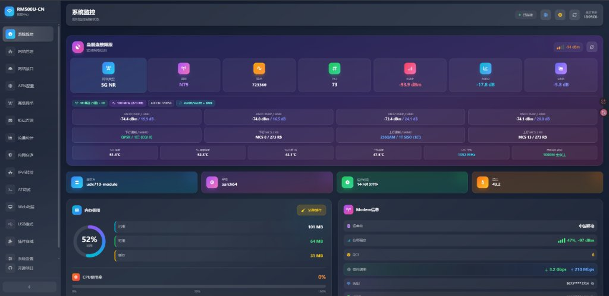

# RM500U-CN Dashboard (UDX710-TOOLS Fork)

[🇨🇳 中文文档](README_CN.md)

A customized lightweight 5G web management dashboard based on [LeoChen-CoreMind/UDX710-TOOLS](https://github.com/LeoChen-CoreMind/UDX710-TOOLS), adapted for **RM500U-CN (UNISOC UDX710)** modules with PCIe Ethernet adapter boards (e.g. RTL8168 / `eth0`).



---

## Key Changes vs. Upstream

### 1. Enhanced 5G NR Radio & Hardware Monitoring (`/api/nr_radio_detail`)
- **4-Antenna Telemetry**: Live per-antenna `ANT0–ANT3` RSRP and SINR readings.
- **Accurate MIMO / Modulation / MCS / Bandwidth Reporting**:
  - Fixed `AT+SP5GCMDS="get nr synch_param",16` field mapping with non-NR guards;
  - Resolved false "idle/standby" MIMO reporting during active downloads and fixed downlink-rank/uplink-rank index swap (`4R 单流 (1层)`, `2x2 MIMO (2层)`, `4x4 MIMO (3层/4层)`, `4x4 就绪 (待机)`);
  - Added channel bandwidth (MHz / RB), Point-A ARFCN, and IMS registration status (`VoNR/VoLTE + SMS`);
  - Independent **2.5s** non-overlapping polling loop on the frontend for `/api/nr_radio_detail`.
- **Thermal, CPU & Ethernet Link**: Multi-zone thermal sensors (SoC, NRCP, PA5G, Board), CPU frequency, `eth0` link speed/duplex, and fixed RAM cache calculation.

### 2. 5G SA SMS TX/RX Fixes
- Automatically enables `AT+IMSEN=1`, configures `AT+CPMS="ME","ME","ME"` and `AT+CNMI=2,1,0,0,0` without manual AT intervention.
- Added background `ME -> SQLite` PDU drainer with 5s deduplication, concatenated SMS **UDH reassembly**, and real `MessageState` delivery tracking.
- Removed the legacy "R106 SMS fix" manual toggle.

### 3. RM500U-CN Platform Adaptation & Cleanup
- **System Info & Network Mode**: Reads model/firmware from `/etc/quectel-project-name` (fallback `AT+CGMR`), supports hexadecimal `/proc/cpuinfo` `Serial`, prefers `org.ofono.RadioSettings` with `AT+SPTESTMODE` fallback, and uses `AT+SPENGMD` fallback for primary serving band.
- **USB Mode Switching**: Replaced risky configfs/IPA hot-switching with `/mnt/data/usbenum.ini` (`virtualcn`) + `sync()`, supporting **RNDIS / CDC-ECM / CDC-NCM / MBIM** (takes effect on reboot).
- **net-tools 2.x Compatibility**: Updated `ifconfig` parser for `eth0:` trailing colons and `ether` MAC format.
- **Hardware Cleanup**: Disabled battery/charging controls, phone-case mode, OTA update popups, and unused SIM Slot 2 UI.
- **Relocatable Deployment**: Relative `./` lookup for `vnstat`, `rathole`, and `Plugins` with configurable listen port (`./server <port>`).

---

## Build

### GitHub Actions
Push to trigger [`.github/workflows/build.yml`](.github/workflows/build.yml), which builds both frontend and `aarch64` backend using the official ARM GNU Toolchain 9.2 (`aarch64-none-linux-gnu-gcc`, targeting `GLIBC 2.30`, compatible with module `GLIBC 2.31`) and uploads a ready-to-deploy artifact (`server`, `dist/`, `start.sh`).

### Local Cross-Compilation
> Note: The target module firmware runs `GLIBC 2.31`. Use a toolchain targeting `GLIBC <= 2.31` (such as ARM GCC 9.2) rather than newer Ubuntu host compilers that emit `GLIBC_2.34+` symbols.

```bash
# 1. Build frontend
cd web
npm install
npm run build

# 2. Cross-compile backend (aarch64)
cd ../src
make CC=aarch64-none-linux-gnu-gcc STRIP=aarch64-none-linux-gnu-strip
# Output: src/build/ofono-server
```

---

## Deployment

1. Copy `src/build/ofono-server` (as `server`) and `web/dist/` to your module directory (e.g. `/home/root/6677/` or `/home/root/6688/`).
2. If upgrading an existing installation, replacing `server` and `dist/` preserves existing databases and runtime utilities; for a fresh directory, provide `vnstat`, `vnstatd`, `vnstatd.conf`, and `rathole` if traffic/tunnel features are needed (`sqlite3` is typically preinstalled on the module).
3. Start the server (default port `6677`, or pass a custom port):
   ```sh
   chmod +x server start.sh
   ./start.sh 6688
   ```
4. Open `http://<module-ip>:6688` (default password: `admin`).

### Prerequisites
- This repository only provides the WebUI and backend server; PCIe NIC kernel drivers (e.g. `r8169.ko` / `yt6801.ko`) and board-level network init scripts are out of scope.
- 5G SA SMS requires VoLTE / IMS SMS service enabled on your SIM plan.

---

## Attribution, Modifications & License

- **Upstream Project**: Derived from [LeoChen-CoreMind/UDX710-TOOLS](https://github.com/LeoChen-CoreMind/UDX710-TOOLS). Original copyright belongs to the upstream authors and contributors.
- **Notice of Modification**: This fork was modified in **November 2026** for RM500U-CN hardware adaptation, 5G SA SMS support, and 4-antenna NR telemetry.
- **License**: Released under the **GNU General Public License v3.0 (GPLv3)** — see [LICENSE](LICENSE) for full terms.
- **Disclaimer**: Provided "AS-IS" without warranty of any kind. Band locking, USB mode changes, and system modifications are performed at your own risk.
